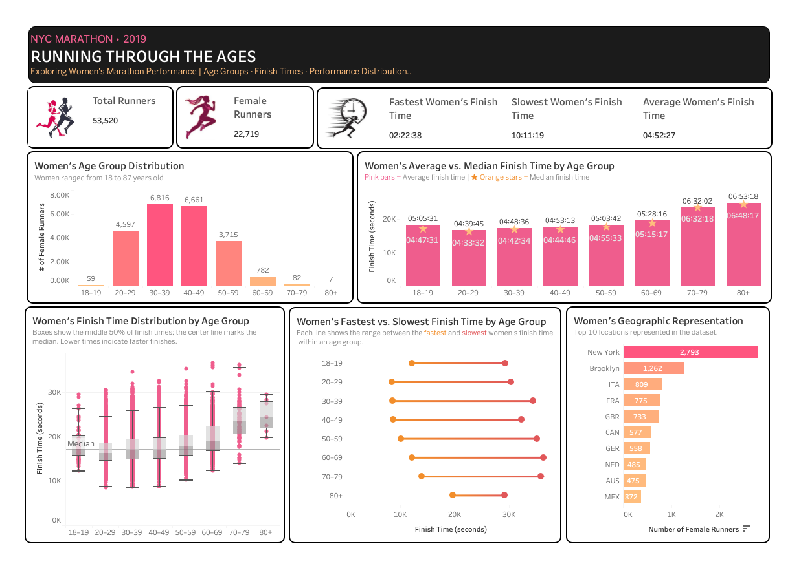

# Women's Running Analytics — NYC Marathon 2019

## 1. Project Overview

The **Women's Running Analytics — NYC Marathon 2019** project explores women's participation and marathon finish-time performance across age groups using the 2019 New York City Marathon results dataset.

SQLite was used to explore, clean, transform, and validate the data. Tableau was then used to analyze performance patterns and build an interactive dashboard titled **Running Through the Ages**.

The analysis examines women's participation by age group, average and median finish times, finish-time distributions, fastest and slowest recorded times, and the locations represented in the dataset.

## 2. Business Problem

Marathon results contain information about runners' ages, gender, and finish times. Analyzing these results can help reveal how women's participation and recorded marathon performances vary across age groups.

**Research question:** How does age relate to women's marathon finish times, and how does the performance distribution vary across age groups?

## 3. Business Objectives

- Measure women's participation across age groups.
- Compare average and median finish times by age group.
- Examine finish-time distributions and variation.
- Compare the fastest and slowest recorded women's finish times in each age group.
- Explore the geographic locations represented in the dataset.
- Communicate the findings through an interactive Tableau dashboard.

## 4. Dataset

The project uses results from the 2019 New York City Marathon.

- **Raw table:** `nyc_marathon_2019_raw`
- **Clean table:** `nyc_marathon_2019_clean`
- **Cleaned CSV:** `nyc_marathon_2019_clean.csv`
- **Total records:** 53,520
- **Female runners:** 22,719
- **Male runners:** 30,801

## 5. Key Data Fields

| Field | Description |
|---|---|
| `place` | Runner's recorded race placement |
| `name` | Runner name as provided in the source |
| `gender` | Recorded gender category |
| `age` | Runner's age |
| `nationality` | Location or nationality value supplied by the source |
| `bib_number` | Runner's bib number |
| `time_full` | Original marathon finish time |
| `time_full_in_seconds` | Finish time converted into total seconds |
| `Race` | Race information provided in the source |
| `Year` | Race year |

## 6. Tools and Skills

- **SQLite:** Data exploration, querying, transformation, and validation
- **DB Browser for SQLite:** Database management and query execution
- **Tableau Public:** Calculated fields, age groups, performance comparisons, and dashboard design
- **GitHub:** SQL versioning, project documentation, and portfolio publication

## 7. Data Preparation and Quality Checks

The SQL workflow included:

- Inspecting the raw table structure and sample records.
- Checking total records and distinct bib numbers.
- Exploring race year, gender, age, and nationality/location values.
- Checking for missing or blank bib numbers.
- Checking women's records for missing ages and missing or blank finish times.
- Testing the original finish-time format and conversion components.
- Converting finish times from `H:MM:SS` into total seconds.
- Creating the clean analytical table.
- Validating the clean table's schema, record count, and converted finish times.

The raw table was retained as the source for the cleaning workflow.

## 8. Analytical Approach

The cleaned CSV was imported into Tableau, where age groups were created for comparison. The dashboard contains five visualizations:

1. Women's Age Group Distribution
2. Women's Average vs. Median Finish Time by Age Group
3. Women's Finish Time Distribution by Age Group
4. Women's Fastest vs. Slowest Finish Time by Age Group
5. Women's Geographic Representation

Five KPI cards summarize total runners, female runners, and women's average, fastest, and slowest finish times.

## 9. Key Findings

### Women's Participation by Age

- The **30–39** age group was the largest, with 6,816 women.
- The **40–49** age group followed closely, with 6,661 women.
- Together, women aged 30–49 represented approximately 59% of female runners.
- Participation declined substantially after age 59.

### Average and Median Finish Times

- Average and median finish times generally increased across age groups from 20–29 through 60–69.
- Average finish times were generally higher than median times, suggesting that slower finishes influenced the averages.
- The 18–19 group had an average finish time of **05:05:31** and a median of **04:47:31**.
- Average and median finish times for the 70–79 group were nearly identical.

### Finish-Time Distribution

- Women aged 20–29 had a median finish time below the overall women's median of 17,071 seconds.
- The 30–39 and 40–49 groups had similar distributions, with medians close to the overall median.
- Median finish times were generally higher in older age groups.
- The 60–69 group included the slowest recorded women's finish time: **10:11:19**.
- The 70–79 and 80+ groups had higher median times, but their smaller participant counts call for caution when interpreting their distributions.

### Fastest and Slowest Finish Times

- The fastest recorded times for ages 20–49 were relatively close, ranging from **02:22:38 to 02:26:21**.
- Fastest times became progressively slower across older age groups.
- The widest fastest-to-slowest range occurred in the 30–39 group.
- The narrowest range occurred in the 80+ group, which had only seven runners.

### Geographic Representation

- New York and Brooklyn were the most frequently listed locations in the women's dataset, with 2,793 and 1,262 records respectively.
- Among the country-code entries, Italy, France, and Great Britain had high representation.
- The source mixes U.S. city/location values with country codes, so these categories are not directly equivalent geographic units.

**Interpretation note:** These findings describe the 2019 dataset and do not establish that age causes performance differences. Results for age groups with few runners should be interpreted cautiously.

## 10. Recommendations

- Use age-group comparisons to understand participation and performance patterns while accounting for group sizes.
- Consider both median and average finish times because averages can be influenced by unusually slow finishes.
- Examine distributions alongside summary statistics to understand variation within age groups.
- Interpret results for the oldest age groups cautiously because of their small sample sizes.
- Standardize geographic categories in future analysis if more precise location comparisons are required.

## 11. Project Structure

```text
Women's_Running_Analytics_NYC_Marathon_2019/
├── README.md
├── data/
│   ├── README.md
│   └── nyc_marathon_2019_clean.csv
├── sql/
│   ├── README.md
│   └── nyc_marathon_2019_analysis.sql
└── tableau/
    ├── README.md
    └── screenshots/
        ├── README.md
        └── Running_Through_the_Ages_NYC_Marathon_2019_Women's_Running_Analytics.png
```

## 12. Project Workflow

1. Imported the original marathon results into SQLite.
2. Explored the raw data and checked key fields.
3. Tested finish-time parsing and conversion.
4. Created and validated a clean analytical table.
5. Exported the cleaned data to CSV.
6. Imported the CSV into Tableau.
7. Created age groups and developed performance visualizations.
8. Designed and published the **Running Through the Ages** dashboard.
9. Documented the workflow and findings on GitHub.

## 13. Tableau Dashboards

### Running Through the Ages

The dashboard explores women's participation, finish-time performance, age-group distributions, and geographic representation in the 2019 NYC Marathon results.

**Tableau Public:** [View the published dashboard](https://public.tableau.com/app/profile/claudia.zelaya/viz/Womens_Running_Analytics_NYC_Marathon_2019/RUNNINGTHROUGHTHEAGES)

### Dashboard Preview



For details about the visualizations and dashboard, see the [Tableau documentation](tableau/README.md).

## 14. Project Documentation

- [SQL documentation](sql/README.md) — exploration, time conversion, clean-table creation, and validation.
- [Data documentation](data/README.md) — cleaned dataset overview and source.
- [Tableau documentation](tableau/README.md) — dashboard details, screenshot, and published workbook link.

## 15. Data Source

The dataset was obtained from the public GitHub repository:

[AndrewMillerOnline — Marathon Results](https://github.com/AndrewMillerOnline/marathon-results)

The source file used was `results-2019.csv`. The cleaned CSV included in this project was prepared for the Tableau analysis.
